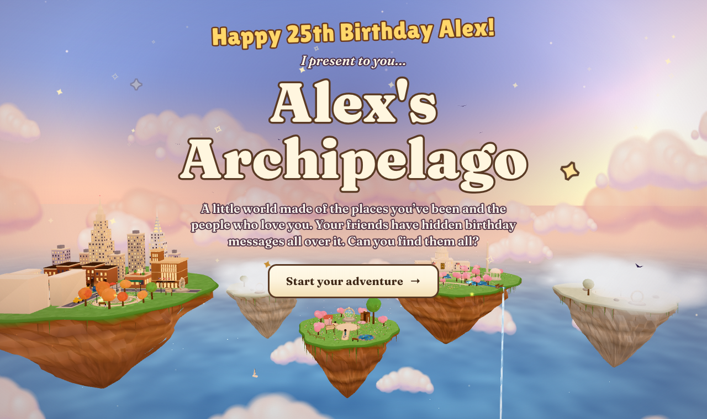
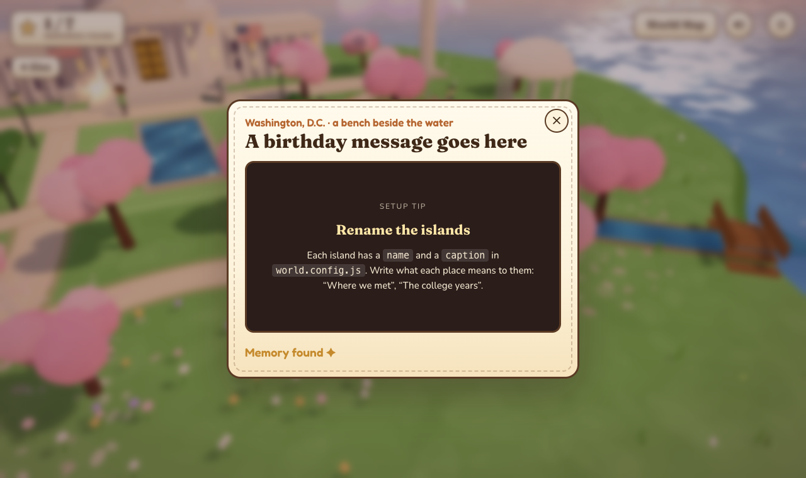

# Birthday Hide & Seek 🏝️

A cozy, Roblox-style 3D world you make for someone's birthday. Their friends' video messages are hidden all over a little archipelago of floating islands, and the birthday person walks around finding them all. Once every message is found, a cake with one candle per year rises on the meadow in the middle and sky lanterns float up.



- **Made for gifting:** one config file holds the name, age, islands, messages, pets and music.
- **Runs anywhere:** plain HTML + JavaScript (three.js), with no build step, no accounts and no server code. Upload the folder to any free static host.
- **Works on phones:** tap to walk, joystick on touch screens, WASD/arrow keys on a computer.
- **Comes with:** New York City (brownstones, a park, the Statue of Liberty, Lincoln Center, the Met, Geffen Hall and Carnegie Hall to walk inside) and Washington, D.C. (the Capitol and its Rotunda, a tidal basin, cherry blossoms and a rideable e-scooter). Plus a cat and a dog who follow you around, a wardrobe of outfits, a Friend Studio to dress up everyone's characters, and two misty "your place here" islands waiting for places of your own.



## Try it

```bash
git clone https://github.com/maganchin/hide-and-seek-birthday-game.git
cd hide-and-seek-birthday-game
python3 serve.py            # → open http://localhost:8026
```

The demo ships without any videos. Every glowing spot opens a **setup tip** instead, so exploring the demo walks you through making your own.

## Make it yours

Everything lives in **[`world.config.js`](world.config.js)**:

```js
birthdayPerson: { name: 'Alex', age: 25, look: { skin: '#efcfb6', hair: '#2a1d18' } },
pets: { cat: { name: 'Mochi' }, dog: { name: 'Biscuit', island: 'nyc' } },
islands: { nyc: { name: 'New York City', caption: 'Where it all started' }, … },
messages: [
  { from: 'Sam', island: 'nyc', spot: 'mailbox', video: 'media/videos/sam.mp4', poster: 'media/posters/sam.jpg' },
  …
],
```

**[SETUP.md](SETUP.md)** is the full walkthrough: collecting videos, making them web-friendly, dressing up friends, adding music, putting it online, and building brand-new islands (with a copy-paste prompt for an AI coding assistant).

## Controls

| | Computer | Phone / tablet |
|---|---|---|
| Walk | click the ground, or WASD / arrow keys | tap the ground, or the joystick |
| Look around | drag, or two-finger scroll | drag |
| Zoom | scroll wheel, or pinch | pinch |
| Open a glowing spot | walk up and press **E**, or click it | tap it |
| World map | **M** | the World Map button |

Handy URL flags: `?skip` jumps past the title screen, `?reset` clears saved progress, `?all` marks every message found, and `?edit=1` (or Shift+F) opens Friend Studio.

## Project layout

```
world.config.js      ← edit this
index.html, style.css
js/main.js           game loop, camera, interactions
js/content.js        reads world.config.js
js/island.js, kit.js island framework and low-poly building helpers
js/islands/*.js      one file per island / interior
js/people.js, avatar.js, friends.js, editor.js   characters and Friend Studio
media/               your videos, posters and music go here
transcode.sh         turns phone videos into small web videos
serve.py             local server (supports video seeking)
vendor/              three.js
```

## Credits & licence

- Code: [MIT](LICENSE). Use it, remix it, make one for everyone you love.
- [three.js](https://threejs.org) (MIT), vendored in `vendor/`.
- Fonts from Google Fonts under the [SIL Open Font License](https://openfontlicense.org): Fraunces, Fredoka, Lilita One, Nunito, Caveat, Cormorant Garamond.
- The landmarks are hand-modelled, low-poly impressions made in code. Not affiliated with Roblox or with any of the places shown.
